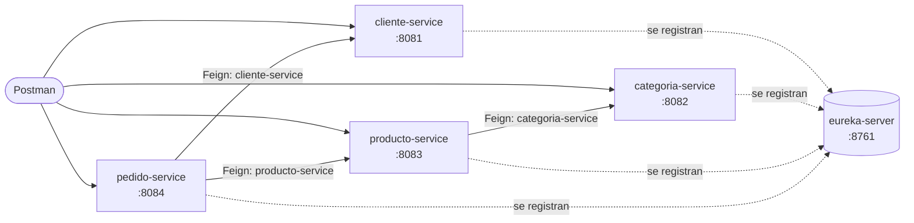

# Semana 12 - Comunicación entre servicios

Los microservicios de la semana 11 se registran en **Eureka** y se llaman entre sí con **OpenFeign** usando el nombre del servicio, sin URL ni puerto fijos.

| Carpeta | Qué tiene |
|---|---|
| [`microservicios/`](./microservicios/) | Laboratorio 12: `eureka-server`, categoría, producto, cliente y pedido |
| [`postman/`](./postman/) | Colección del laboratorio, con casos exitosos y de error |
| [`evaluacion_3/`](./evaluacion_3/) | Evaluación 03: gestión de pagos de servicios |

## Tecnologías

- Java 21
- Spring Boot 3.5.15
- Spring Cloud 2025.0.0 (Netflix Eureka, OpenFeign)
- Spring Web, Spring Data JPA, Jakarta Bean Validation
- Lombok
- MariaDB
- Maven
- Postman

## Servicios

| Servicio | Puerto | Base de datos | Ruta |
|---|---|---|---|
| `eureka-server` | 8761 | - | `http://localhost:8761` (panel) |
| `cliente-service` | 8081 | `bd_cliente_s12_dev` | `/api/clientes` |
| `categoria-service` | 8082 | `bd_categoria_dev` | `/api/categorias` |
| `producto-service` | 8083 | `bd_producto_dev` | `/api/productos` |
| `pedido-service` | 8084 | `bd_pedido_dev` | `/api/pedidos` |

Cada servicio tiene su propia base de datos y se crea sola al arrancar (`createDatabaseIfNotExist=true`). La de cliente se llama `bd_cliente_s12_dev` porque `bd_cliente_dev` ya la usa la Evaluación 03 con otra tabla `cliente`.



## Cómo ejecutarlo

1. Tener MariaDB en el puerto 3307.
2. Definir la contraseña local:

```bash
export DB_PASSWORD='tu-clave'
```

En IntelliJ, `DB_PASSWORD` va en **Run → Edit Configurations → Environment variables**. El usuario es `root`, salvo que se defina `DB_USER`.

3. Levantar primero `eureka-server` y después los 4 servicios, cada uno en su carpeta:

```bash
./mvnw spring-boot:run
```

4. Abrir `http://localhost:8761`. En **Instances currently registered with Eureka** deben aparecer `CATEGORIA-SERVICE`, `CLIENTE-SERVICE`, `PRODUCTO-SERVICE` y `PEDIDO-SERVICE`. Un servicio recién levantado puede tardar unos 30 segundos en ser visible para los demás.

## Comunicación entre servicios

Los clientes Feign usan el nombre registrado en Eureka, no la URL:

```java
@FeignClient(name = "cliente-service")
public interface ClienteClient {

    @GetMapping("/api/clientes/{id}")
    ClienteDTO obtenerCliente(@PathVariable Long id);
}
```

`pedido-service` guarda solo `clienteId` y `productoId`, sin relaciones JPA ni datos copiados. Al consultar un pedido, completa la respuesta con los otros dos servicios:

```text
GET /api/pedidos/{id}
  ├─ busca el pedido en bd_pedido_dev
  ├─ Feign → cliente-service  /api/clientes/{id}
  ├─ Feign → producto-service /api/productos/{id}
  └─ responde el pedido completo
```

```json
{
  "id": 1,
  "cantidad": 2,
  "estado": "PENDIENTE",
  "clienteId": 1,
  "productoId": 1,
  "cliente": { "id": 1, "nombre": "Carlos", "apellido": "Ramirez" },
  "producto": { "id": 1, "nombre": "Laptop", "precio": 2500.0 }
}
```

Al registrar un pedido o un producto, primero se confirma que el cliente, el producto o la categoría existen. Si no existen, no se guarda nada.

| Caso | Respuesta |
|---|---|
| Datos correctos | `200` / `201` |
| Validación fallida o JSON mal formado | `400` |
| Registro que no existe (propio o del otro servicio) | `404` |
| Servicio llamado apagado | `500` · `No se pudo comunicar con cliente-service` |

Con `cliente-service` apagado, los pedidos se siguen listando, pero no se pueden consultar ni registrar. `producto-service` sigue respondiendo.

## Endpoints

### Cliente (`:8081`)

| Método | Ruta | Descripción |
|---|---|---|
| `GET` | `/api/clientes` | Listar |
| `GET` | `/api/clientes/{id}` | Consultar por código |
| `POST` | `/api/clientes` | Registrar |
| `PUT` | `/api/clientes/{id}` | Actualizar |
| `DELETE` | `/api/clientes/{id}` | Eliminar |

Validaciones: `nombre`, `apellido`, `direccion`, `estado` y `nroDni` obligatorios. `nroDni` con exactamente 8 dígitos.

### Categoría (`:8082`)

| Método | Ruta | Descripción |
|---|---|---|
| `GET` | `/api/categorias` | Listar |
| `GET` | `/api/categorias/{id}` | Buscar |
| `POST` | `/api/categorias` | Registrar |
| `PUT` | `/api/categorias/{id}` | Actualizar |
| `DELETE` | `/api/categorias/{id}` | Eliminar |

### Producto (`:8083`)

| Método | Ruta | Descripción |
|---|---|---|
| `GET` | `/api/productos` | Listar |
| `GET` | `/api/productos/{id}` | Buscar, con su categoría |
| `POST` | `/api/productos` | Registrar (valida la categoría) |
| `PUT` | `/api/productos/{id}` | Actualizar |
| `DELETE` | `/api/productos/{id}` | Eliminar |

Validaciones: `nombre` obligatorio, `precio` mayor a cero, `stock` no negativo y `categoriaId` obligatorio.

### Pedido (`:8084`)

| Método | Ruta | Descripción |
|---|---|---|
| `GET` | `/api/pedidos` | Listar |
| `GET` | `/api/pedidos/{id}` | Consultar con cliente y producto |
| `POST` | `/api/pedidos` | Registrar (queda `PENDIENTE`) |
| `PATCH` | `/api/pedidos/{id}/estado` | Cambiar a `PENDIENTE`, `ATENDIDO` o `ANULADO` |

Un pedido no se elimina: `DELETE` responde `405`. Validaciones: `clienteId` y `productoId` obligatorios, `cantidad` mayor a cero.

## Pruebas

La colección [`postman/Lab_S12_Microservicios.postman_collection.json`](./postman/Lab_S12_Microservicios.postman_collection.json) tiene 36 peticiones en orden: categoría, producto, cliente y pedido. Guarda los `id` creados en variables, así que se puede correr varias veces sin limpiar la base de datos.

```bash
npx newman run postman/Lab_S12_Microservicios.postman_collection.json
```

Resultado: 36 peticiones, 65 validaciones, 0 fallidas.

## Autor

**Victor Manuel Santamaria Fabian**

Diseño y Desarrollo de Software - Tecsup
