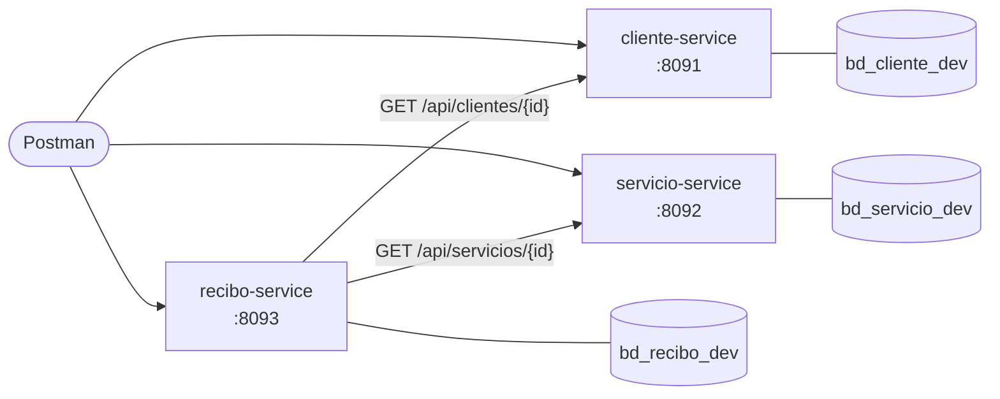

# Evaluación 03 - Gestión de pagos de servicios

Una empresa necesita controlar a sus clientes, los servicios que cobra (luz, agua, internet) y los recibos de cada mes. El sistema está dividido en tres microservicios independientes. Cada uno es su propio proyecto Spring Boot, con su puerto y su base de datos, y se comunican por HTTP.

| Carpeta | Qué tiene |
|---|---|
| [`cliente-service/`](./cliente-service/) | CRUD de clientes |
| [`servicio-service/`](./servicio-service/) | CRUD de servicios |
| [`recibo-service/`](./recibo-service/) | Recibos: registro, pago y consultas |
| [`sql/`](./sql/) | Scripts de las bases de datos: `dev.sql` (laptop) y `prod.sql` (servidor) |
| [`postman/`](./postman/) | Colección con casos exitosos y fallidos |

## Requisitos

- Java 21
- Spring Boot 4.1.1 (Spring Web MVC, Spring Data JPA, Validation, DevTools)
- MariaDB en el puerto 3307
- Maven (viene el wrapper `mvnw`)
- Postman

## Diagrama



| Servicio | Responsabilidad | Puerto dev / prod | Base de datos dev / prod | Ruta |
|---|---|---|---|---|
| `cliente-service` | Datos de los clientes | 8091 / 9091 | `bd_cliente_dev` / `bd_cliente` | `/api/clientes` |
| `servicio-service` | Catálogo de servicios y su empresa | 8092 / 9092 | `bd_servicio_dev` / `bd_servicio` | `/api/servicios` |
| `recibo-service` | Recibos por cliente, servicio y periodo; su estado de pago | 8093 / 9093 | `bd_recibo_dev` / `bd_recibo` | `/api/recibos` |

Cada servicio tiene los paquetes `model`, `dto`, `repository`, `services`, `controller` y `exception`. `recibo-service` suma `client`, con las llamadas a los otros dos.

## Cómo ejecutarlo

1. Crear las bases de datos con [`sql/dev.sql`](./sql/dev.sql). En dev, las tablas las crea Hibernate al arrancar. El script también borra las bases dev, así la colección se corre desde cero.

```bash
mariadb -h 127.0.0.1 -P 3307 -u root -p < sql/dev.sql
```

2. Definir la contraseña local y levantar **los tres servicios**, cada uno en su carpeta y en su propia terminal:

```bash
export DB_PASSWORD='tu-clave'
./mvnw spring-boot:run
```

En IntelliJ, `DB_PASSWORD` va en **Run → Edit Configurations → Environment variables**. El usuario es `root`, salvo que se defina `DB_USER`.

## Perfiles

`application.yml` tiene el nombre del servicio y activa `dev`. Lo que cambia por ambiente está en `application-dev.yml` y `application-prod.yml`:

| Valor | dev | prod |
|---|---|---|
| Puerto | 8091, 8092, 8093 | 9091, 9092, 9093 |
| Host de la BD | `localhost:3307` | `${DB_HOST:servidor}:${DB_PORT:3306}` |
| Base de datos | `bd_*_dev` | `bd_*` |
| Usuario | `${DB_USER:root}` | `${DB_USER}`, sin valor por defecto |
| `ddl-auto` | `update`: Hibernate crea y ajusta las tablas | `validate`: solo comprueba que las tablas coincidan con las entidades |
| `show-sql` | `true` | `false` |
| URL de los otros servicios (`recibo-service`) | `http://localhost:8091` y `:8092` | `${CLIENTE_URL}` y `${SERVICIO_URL}` |

Para levantar en prod, en el servidor y después de correr [`sql/prod.sql`](./sql/prod.sql) (`validate` no crea tablas):

```bash
export SPRING_PROFILES_ACTIVE=prod
export DB_HOST=servidor DB_PORT=3306 DB_USER=usuario DB_PASSWORD='clave'
export CLIENTE_URL=http://servidor:9091 SERVICIO_URL=http://servidor:9092
./mvnw spring-boot:run
```

Se probó en la laptop con `DB_HOST=localhost` y `DB_PORT=3307`: `recibo-service` levanta en el 9093, valida la tabla y responde. En la laptop, `prod.sql` no se corre, porque `bd_cliente` es también la base del `cliente-service` del Lab S11.

## Comunicación entre servicios

`recibo-service` guarda `id_cliente` e `id_servicio` sin llave foránea, porque esos datos viven en otras bases. Antes de registrar o modificar un recibo los consulta por HTTP con `ClienteClient` y `ServicioClient` (`RestClient`):

```text
POST /api/recibos
  ├─ GET cliente-service/api/clientes/{id}     → ¿existe y está activo?
  ├─ GET servicio-service/api/servicios/{id}   → ¿existe y está activo?
  └─ guarda en bd_recibo_dev
```

## Reglas del negocio

| Regla | Respuesta |
|---|---|
| `monto` positivo, con hasta 2 decimales | `400` · `El monto debe ser positivo` |
| `periodo` obligatorio y con formato `AAAA-MM` | `400` · `El periodo es obligatorio` |
| `idCliente`, `idServicio` y `fechaVencimiento` obligatorios | `400`, con un mensaje por campo |
| Un recibo nuevo siempre empieza en `PENDIENTE` | El JSON no recibe `estadoPago` |
| Solo se paga un recibo `PENDIENTE` | `400` · `El recibo 1 ya está pagado` |
| Un recibo `PAGADO` no se modifica ni se elimina | `400` |
| Un cliente no tiene dos recibos del mismo servicio en el mismo periodo | `400` |
| Cliente o servicio que no existe | `404` |
| Cliente o servicio inactivo | `400` · `El cliente 2 está inactivo` |
| `cliente-service` o `servicio-service` apagado | `503` · `No se pudo comunicar con servicio-service` |
| ID que no existe, o JSON o ID con mal formato | `404`, o `400` · `La petición tiene un formato inválido` |

Eliminar un cliente o un servicio cambia su `estado` de `A` a `I` y deja de salir en la lista. Así sus recibos no quedan apuntando a un registro borrado. Los errores los atiende `GlobalExceptionHandler` (`@RestControllerAdvice`) en cada servicio.

## Endpoints

```http
POST   /api/clientes
GET    /api/clientes
GET    /api/clientes/{id}
PUT    /api/clientes/{id}
DELETE /api/clientes/{id}

POST   /api/servicios
GET    /api/servicios
GET    /api/servicios/{id}
PUT    /api/servicios/{id}
DELETE /api/servicios/{id}

POST   /api/recibos
GET    /api/recibos
GET    /api/recibos?estado=PENDIENTE
GET    /api/recibos/cliente/{idCliente}
GET    /api/recibos/{id}
PUT    /api/recibos/{id}
PATCH  /api/recibos/{id}/pagar
DELETE /api/recibos/{id}
```

Ejemplo de recibo:

```json
{
  "idCliente": 1,
  "idServicio": 1,
  "periodo": "2026-11",
  "monto": 125.50,
  "fechaVencimiento": "2026-11-20"
}
```

## Pruebas en Postman

Con los servicios levantados y **las bases de datos vacías** (correr antes `sql/dev.sql` y reiniciar los servicios), importar [`Evaluacion_03_Pagos`](./postman/Evaluacion_03_Pagos.postman_collection.json) y correrla en orden (**Run collection**). Cada POST guarda el `id` creado en una variable.

| Carpeta | Peticiones | Exitosas | De error |
|---|---|---|---|
| Cliente | 9 | 6 | 3 |
| Servicio | 9 | 6 | 3 |
| Recibo | 22 | 9 | 13 |

**Prueba de aceptación**, en la carpeta Recibo: *Registrar recibo de luz* (`PENDIENTE`) → *Marcar pagado el recibo de luz* → *Consultar el recibo pagado* (`PAGADO`).

El caso de servicio caído se prueba a mano: apagar `servicio-service` y registrar un recibo. Responde `503`.

## Conclusiones

1. Separar por dominio (clientes, servicios, recibos) deja que cada servicio cambie y se despliegue solo. Si `servicio-service` se cae, los clientes y los recibos ya registrados se siguen consultando.
2. Sin una base compartida no hay llaves foráneas entre servicios. La integridad pasa al código: `recibo-service` pregunta por HTTP si el cliente y el servicio existen antes de guardar.
3. El DTO separa lo que el cliente puede enviar de lo que se guarda. Por eso `estadoPago` no se acepta en el POST y solo cambia con `PATCH /pagar`.
4. Con `@RestControllerAdvice`, todos los errores salen con el mismo formato y el código HTTP correcto (400, 404, 503), en lugar de un 500 genérico.
5. Con los perfiles, el mismo código corre en dev y prod cambiando solo la configuración. Lo sensible (contraseña, host) va en variables de entorno, no en el repositorio.

**Dificultad:** el nombre que sugiere la guía, `bd_cliente`, ya lo usa el Lab S11 (el `cliente-service` de la tienda, también con una tabla `cliente`, en el puerto 8081). En la misma MariaDB, los dos proyectos habrían escrito en la misma tabla, y Hibernate (`ddl-auto: update`) la habría ido cambiando según cuál arrancara. **Solución:** en dev, bases con el sufijo `_dev` (la convención del `categoria-service` del Lab S11) y puertos 809x. Los nombres de la guía (`bd_cliente`, `bd_servicio`, `bd_recibo`) quedan para prod, que corre en otro servidor.

## Autor

**Victor Manuel Santamaria Fabian**

Diseño y Desarrollo de Software - Tecsup
